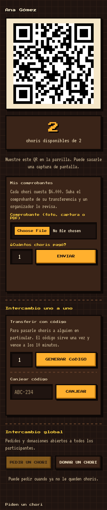
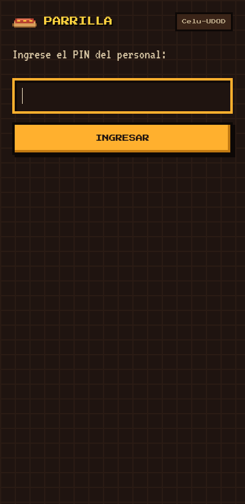
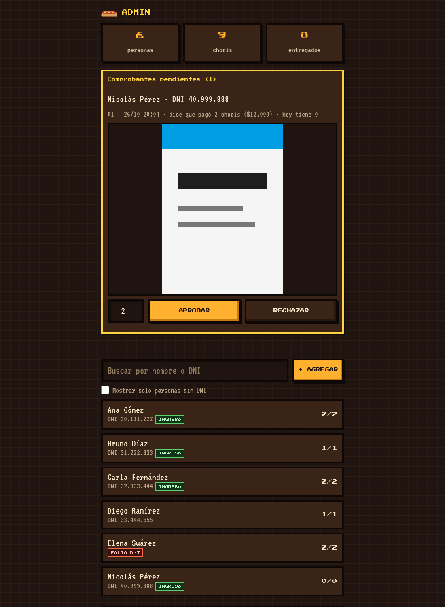

# Chori QR

Una app web para entregar comida prepaga en un evento. Cada asistente entra
con su DNI y muestra un QR. El asador escanea el QR con el celular, ve cuántos
choris le quedan a esa persona y descuenta uno.

La hice para una choripaneada en la que cada persona pagó por adelantado 1, 2 o
3 choris. Sirve igual para cualquier cosa que se pague antes y se retire en el
evento: bebidas, entradas a un buffet, kits, etc.

- **Sin dependencias:** solo la biblioteca estándar de Python y SQLite. No hay
  `pip install`, `npm` ni build.
- **Varios celulares a la vez:** el descuento es atómico. Aunque dos asadores
  escaneen el mismo QR al mismo tiempo, no se entrega más de lo pagado.
- **Estilo pixel art** en las tres páginas.

| Portal del asistente | Escáner del asador | Panel de admin |
|---|---|---|
|  |  |  |

> Las capturas usan datos ficticios.

## Qué hace

### Portal del asistente (`/`)

- Ingreso con DNI. Las personas precargadas entran la primera vez con el DNI
  como usuario y contraseña, y la app les pide elegir una contraseña propia.
  Si el DNI no tiene cuenta, lo dice ("Cuenta inexistente") y sugiere crearla.
- Muestra el QR personal y cuántos choris le quedan.
- **QR grande** a pantalla completa con fondo blanco, para escanear rápido con
  humo o poca luz. Mantiene la pantalla encendida mientras está abierto.
- **Aviso de entrega:** cuando el asador descuenta, el portal se pone verde y
  dice "¡Entregado!" con lo que le queda.
- Funciona sin señal: el QR ya está dibujado y un aviso lo indica.
- **Crear cuenta:** quien no estaba en la lista se registra con su DNI y una
  contraseña, y sube el comprobante de pago (foto o PDF, hasta 8 MB). Un
  organizador lo aprueba con la cantidad que corresponda o lo rechaza con un
  motivo, que el asistente ve en su portal. La recepción de comprobantes se
  puede cerrar cuando termina la venta.
- **Intercambio uno a uno:** genera un código (por ejemplo `K7M-2QX`) para pasarle
  uno o varios choris a otra persona. Sirve una vez y vence a los 10 minutos.
- **Intercambio global:** cualquiera puede pedir un chori o donar uno, y hay una
  lista con los pedidos y las donaciones abiertas. Una cuenta nueva (que nunca
  tuvo choris) puede tomar una donación solo si quien la ofreció lo aprueba.

### Escáner del asador (`/staff`)

- Se entra con un PIN compartido por el personal.
- Pitidos de 8 bits y vibración al aprobar, rechazar y entregar.
- Escanea el QR con la cámara trasera y muestra el nombre y el saldo con un
  ✔ verde o un ✖ rojo.
- Botón para entregar, deshacer la última entrega y buscar por nombre por si
  alguien no tiene el QR a mano.

### Panel de admin (`/admin`)

- Se entra con otro PIN.
- Totales: personas, choris vendidos y entregados.
- Comprobantes pendientes con la imagen o el PDF, aviso si el mismo archivo ya
  se subió antes (se compara el hash SHA-256), y botones para aprobar o rechazar.
- Agregar personas, completar el DNI, cambiar cantidades y resetear contraseñas.
- Lista de bloqueados con botón para desbloquear.
- Registro de accesos: cada ingreso, cambio de contraseña y acción del admin, con
  el DNI, el resultado y la IP. Nunca guarda contraseñas ni PIN.

### Seguridad

- Contraseñas con scrypt; sesiones en cookies `HttpOnly`, `SameSite=Strict` y
  `Secure` (si `COOKIE_SECURE=1`).
- Tres intentos fallidos bloquean 15 minutos: por DNI en el portal y por IP en
  los PIN del asador y del admin.
- Límite de 5 cuentas nuevas por hora por IP.
- El tipo de archivo de los comprobantes se detecta por su contenido, no por la
  extensión.
- Con dominios separados (ver [Publicarlo](#publicarlo-con-dominios-propios)),
  cada dominio sirve solo su página y su API.

## Probarlo en local

Hace falta Python 3.10 o más nuevo. No se instala nada más.

```bash
git clone https://github.com/FranciscoCross/chori-qr.git
cd chori-qr

# 1. Cargar las personas de ejemplo en una base nueva
DB_PATH=./data/chori.db python3 app/server.py importar ejemplo/personas.csv

# 2. Iniciar el servidor
DB_PATH=./data/chori.db COOKIE_SECURE=0 STAFF_PIN=1234 ADMIN_PIN=5678 PORT=8080 \
  python3 app/server.py
```

Abrir:

| Página | URL | Acceso de prueba |
|---|---|---|
| Asistente | http://localhost:8080/ | DNI `30111222` y contraseña `30111222` (Ana Gómez) |
| Asador | http://localhost:8080/staff | PIN `1234` |
| Admin | http://localhost:8080/admin | PIN `5678` |

`COOKIE_SECURE=0` hace falta porque en local no hay HTTPS: sin eso el navegador
no guarda la cookie de sesión.

### Probar el escáner con el celular

El navegador solo deja usar la cámara en `https://` o en `localhost`, así que
abrir `http://192.168.x.x:8080/staff` desde el celular no alcanza. Dos opciones
rápidas:

- **Túnel temporal de Cloudflare** (no requiere cuenta):
  `cloudflared tunnel --url http://localhost:8080` y abrir en el celular la URL
  `https://….trycloudflare.com/staff` que imprime. Ver la
  [documentación de Quick Tunnels](https://developers.cloudflare.com/cloudflare-one/connections/connect-networks/do-more-with-tunnels/trycloudflare/).
  En este caso usar `COOKIE_SECURE=1`.
- **Dos ventanas en la compu:** abrir el portal de Ana en una ventana normal y
  `/staff` en otra (o en el celular apuntando al QR de la pantalla).

### Un recorrido completo

1. En `/`, entrar como Ana (`30111222` / `30111222`) y elegir una contraseña.
2. En `/staff`, entrar con el PIN y escanear el QR de Ana: aparece "2 choris
   disponibles". Entregar uno.
3. En el portal de Ana el saldo pasa a 1 (se actualiza cada 15 segundos).
4. Con Ana, generar un código de 1 chori. En otra ventana privada, entrar como
   Bruno (`31222333`) y canjearlo.
5. En otra ventana privada, tocar **Crear cuenta**, registrarse con un DNI
   cualquiera y subir una imagen como comprobante.
6. En `/admin`, aprobar ese comprobante: la cuenta nueva ya tiene choris.

## Levantarlo con Docker

No hay imagen propia: el contenedor usa `python:3.13-slim` y monta el código.

```bash
cp .env.example .env        # cambiar STAFF_PIN y ADMIN_PIN
mkdir -p data
docker compose up -d        # http://localhost:8080

# Cargar personas desde un CSV
docker compose run --rm --no-deps -v ./ejemplo:/datos:ro app \
  python /app/server.py importar /datos/personas.csv

docker compose logs -f app
```

La base y los comprobantes quedan en `./data/`. Para generar PIN al azar:

```bash
python3 -c "import secrets; print(secrets.token_urlsafe(9))"
```

### Publicarlo con dominios propios

`compose.traefik.yaml` agrega las etiquetas para
[Traefik v3](https://doc.traefik.io/traefik/routing/providers/docker/) con un
dominio por página. Definir `HOST_USERS`, `HOST_STAFF` y `HOST_ADMIN` en `.env` y:

```bash
docker compose -f compose.yaml -f compose.traefik.yaml up -d
```

Supone una red externa `traefik`, un entrypoint `websecure` y un certresolver
`letsencrypt`; cambiar esos nombres si su Traefik usa otros. Funciona igual
detrás de un [Cloudflare Tunnel](https://developers.cloudflare.com/cloudflare-one/connections/connect-networks/)
apuntando a Traefik. Yo lo corrí así en una Raspberry Pi.

Si no usa Traefik, cualquier proxy con HTTPS sirve. Sin las variables `HOST_*`
las tres páginas quedan en un solo dominio (`/`, `/staff` y `/admin`).

Detrás de un proxy, el servidor toma la IP del cliente de `Cf-Connecting-Ip`
(Cloudflare) o `X-Forwarded-For`; se usa para los bloqueos por IP y el registro.

## Configuración

| Variable | Por defecto | Para qué |
|---|---|---|
| `STAFF_PIN` | (obligatoria) | PIN del escáner del asador |
| `ADMIN_PIN` | (obligatoria) | PIN del panel de admin; tiene que ser distinto de `STAFF_PIN` |
| `DB_PATH` | `/data/chori.db` | Base SQLite; los comprobantes van en `comprobantes/` al lado |
| `PORT` | `8080` | Puerto del servidor |
| `COOKIE_SECURE` | `1` | `0` para probar sin HTTPS |
| `PRECIO_CHORI` | `6000` | Precio que se muestra al subir el comprobante |
| `RESERVAS_CERRADAS` | `0` | `1` para cerrar la venta: no se reciben más comprobantes (ver abajo) |
| `HOST_USERS`, `HOST_STAFF`, `HOST_ADMIN` | (vacías) | Un dominio por página |

### Cerrar la venta

Cuando termina la reserva, `RESERVAS_CERRADAS=1` deja de recibir comprobantes:
la sección "Mis comprobantes" del portal queda en gris (el historial se sigue
viendo) y el servidor rechaza cualquier subida. Crear cuenta sigue habilitado,
porque una cuenta nueva todavía puede recibir choris por código o por una
donación aprobada. Con Docker:

```bash
echo RESERVAS_CERRADAS=1 >> .env
docker compose up -d --force-recreate app
```

Otros valores (intentos antes del bloqueo, minutos de vencimiento de los
códigos, tamaño máximo del comprobante) son constantes al principio de
`app/server.py`.

## Cargar la lista de asistentes

CSV con encabezado `nombre,dni,cantidad` (la columna `nota` es opcional y se
ignora). Ver [`ejemplo/personas.csv`](ejemplo/personas.csv).

```csv
nombre,dni,cantidad,nota
Ana Gómez,30111222,2,
Elena Suárez,,2,falta el DNI: se completa desde el admin
```

- El DNI puede venir con puntos; se guarda solo con dígitos.
- Si falta el DNI, la persona se crea igual pero no puede entrar hasta que se
  complete desde el admin.
- Volver a importar el mismo archivo no duplica: omite a quien ya exista por DNI
  o por nombre.

> **Datos personales:** el CSV real y la carpeta `data/` tienen DNI, nombres y
> comprobantes de pago. `.gitignore` los excluye; no los suba a un repositorio.

## Consultas útiles

```bash
sqlite3 data/chori.db "select nombre, dni, restantes, total from personas order by nombre;"
sqlite3 data/chori.db "select sum(total), sum(total - restantes) from personas;"   # vendidos / entregados
docker compose logs app | grep AUDIT                                             # registro de accesos
```

Después del evento conviene borrar los datos personales:

```bash
sqlite3 data/chori.db "delete from auditoria;"   # DNI e IP de cada ingreso
rm -rf data/comprobantes                          # comprobantes subidos
```

## Estructura

```
app/server.py          servidor HTTP, API y base de datos (un solo archivo)
app/static/index.html  portal del asistente
app/static/staff.html  escáner del asador
app/static/admin.html  panel de admin
ejemplo/personas.csv   lista de prueba con datos ficticios
compose.yaml           Docker para uso local
compose.traefik.yaml   agregado para publicar con Traefik
```

En el navegador se usan [qrcodejs](https://github.com/davidshimjs/qrcodejs)
para dibujar el QR y [html5-qrcode](https://github.com/mebjas/html5-qrcode) para
leerlo, cargados desde CDN, y las fuentes Press Start 2P y VT323 de Google Fonts.

## Limitaciones

- Un solo proceso con SQLite: alcanza de sobra para un evento de cientos de
  personas, no para miles de escaneos por segundo.
- Los bloqueos por intentos fallidos viven en memoria y se borran al reiniciar.
- Los pagos se validan a mano mirando el comprobante; no hay integración con
  medios de pago.

## Licencia

[MIT](LICENSE): úselo, cámbielo y compártalo para lo que quiera.
